# ShareNote – galutinė projekto ataskaita

Sąrašų puslapiavimas ir API `page` / `size` parametrai: [dokumentacija](docs/pagination.md).

Backend paketų struktūra ir patikros komandos: [backend/README.md](backend/README.md).

## 1. Sprendžiamo uždavinio aprašymas

### 1.1. Sistemos paskirtis

Komandos ar studijų grupės užrašai dažnai išskaidomi skirtinguose dokumentuose ir susirašinėjimuose. Dėl to sunku rasti reikalingą informaciją ir suprasti, kuriai temai ar grupei ji priklauso. **ShareNote** skirta bendriems užrašams kaupti, skaityti ir tvarkyti vienoje internetinėje sistemoje.

Biblioteką sudaro organizacijos, grupės ir užrašai. Organizacija gali turėti daug grupių; kiekviena grupė privalo priklausyti vienai organizacijai. Kiekvienas užrašas privalo priklausyti vienai grupei ir turi antraštę, turinį bei kategoriją.

Sistemoje yra trys vaidmenys: **USER (skaitytojas)** peržiūri duomenis, **EDITOR (redaktorius)** kuria užrašus ir keičia bei šalina tik savo užrašus, o **ADMIN (administratorius)** valdo visus išteklius. Užrašo savininko ID lyginamas su JWT `sub`. [Autorizacija ir EDITOR rolės suteikimas](docs/authorization.md). Visi prisijungę naudotojai mato visą biblioteką: organizacijos ir grupės naudojamos informacijai susisteminti, individuali narystė ar privatūs užrašai nerealizuoti.

### 1.2. Funkciniai reikalavimai

| ID | Reikalavimas | Realizacija |
| --- | --- | --- |
| FR-01 | Registruoti naudotoją | Registracijos forma ir `POST /api/auth/register`; suteikiamas USER vaidmuo. |
| FR-02 | Prisijungti ir atsijungti | Prisijungus gaunamas JWT; atsijungiant pašalinama naršyklės sesija. |
| FR-03 | Riboti veiksmus pagal vaidmenį | USER, EDITOR ir ADMIN skaito; EDITOR kuria užrašus ir keičia bei trina tik savo pagal naudotojo ID; ADMIN valdo visus išteklius. Teises tikrina API. |
| FR-04 | Tvarkyti organizacijas | Sąrašas, peržiūra pagal ID, sukūrimas, pakeitimas ir ištrynimas. |
| FR-05 | Tvarkyti grupes | Penkios CRUD operacijos; organizacijos priskyrimas privalomas. |
| FR-06 | Tvarkyti užrašus | Penkios CRUD operacijos; privaloma antraštė, turinys, kategorija ir grupė. |
| FR-07 | Ieškoti ir filtruoti | Naršyklėje ieškoma pagal pavadinimą, turinį / aprašymą ir kategoriją; užrašai filtruojami pagal grupę, grupės – pagal organizaciją. API palaiko `groupId` ir `organizationId` filtrus. |
| FR-08 | Tikrinti įvestį | Tikrinami privalomi laukai, jų ilgis, tipai ir teigiami ryšių ID; klaidos rodomos sąsajoje. |
| FR-09 | Išlaikyti ryšių vientisumą | Negalima ištrinti grupės su užrašais arba organizacijos su grupėmis. Grąžinamas 409. |
| FR-10 | Patvirtinti trynimą | Prieš DELETE rodomas patvirtinimo dialogas. |
| FR-11 | Informuoti apie būseną | Rodomas duomenų krovimas, tuščias sąrašas, klaidos ir sėkmės pranešimai. Pasibaigus sesijai grįžtama į prisijungimą. |
| FR-12 | Naudotis skirtinguose ekranuose | Prisitaikantis išdėstymas, mobilusis meniu, klaviatūra valdomi dialogai ir pagalbos langas. |

### 1.3. Duomenų ir prieigos taisyklės

| Objektas | Laukai ir apribojimai |
| --- | --- |
| Organizacija | `id` sugeneruojamas; `name` – 1–120 simbolių, ne vien tarpai; `description` – privaloma eilutė iki 2000 simbolių, gali būti tuščia. |
| Grupė | `id`, `name`, `description` kaip organizacijos; `organizationId` – privalomas teigiamas egzistuojančios organizacijos ID. Hierarchiniuose keliuose organizaciją nurodo URL. |
| Užrašas | `id` sugeneruojamas; `title` – 1–200, `content` – 1–20 000, `category` – 1–100 simbolių; reikšmės negali būti vien tarpai; `groupId` – privalomas teigiamas egzistuojančios grupės ID. |
| Paskyra | `username` – 3–80 lotyniškų raidžių, skaičių arba `_.-`; raidžių dydis nesvarbus. `password` – bent 12 simbolių ir ne daugiau kaip 72 UTF-8 baitai. Slaptažodis saugomas BCrypt maišos pavidalu. |

JWT galioja 180 sekundžių (3 minutės), turi `sub`, `username`, `role`, `iss`, `iat`, `exp` laukus ir pasirašomas RS256. API nenaudoja serverio HTTP sesijų. Naršyklė prieigos ir atnaujinimo žetonus saugo `localStorage`. Atnaujinimo žetonas taip pat yra pasirašytas JWT ir galioja iki 2 dienų nuo prisijungimo ir kiekvieną kartą pakeičiamas nauju. Naršyklė automatiškai atnaujina JWT prieš galiojimo pabaigą arba gavusi 401. API paleidžiant generuojama nauja RSA raktų pora; todėl abu JWT žetonai nebegalioja ir reikia prisijungti iš naujo. Atsijungimas atšaukia atnaujinimo žetoną, bet jau išduotas JWT galioja iki galiojimo pabaigos. [Žetonų atnaujinimo API ir veikimas](docs/token-renewal.md).

## 2. Sistemos architektūra

Frontend failų struktūra, modulių atsakomybės ir kūrimo komandos aprašytos [frontend/README.md](frontend/README.md).

### 2.1. UML diegimo diagrama

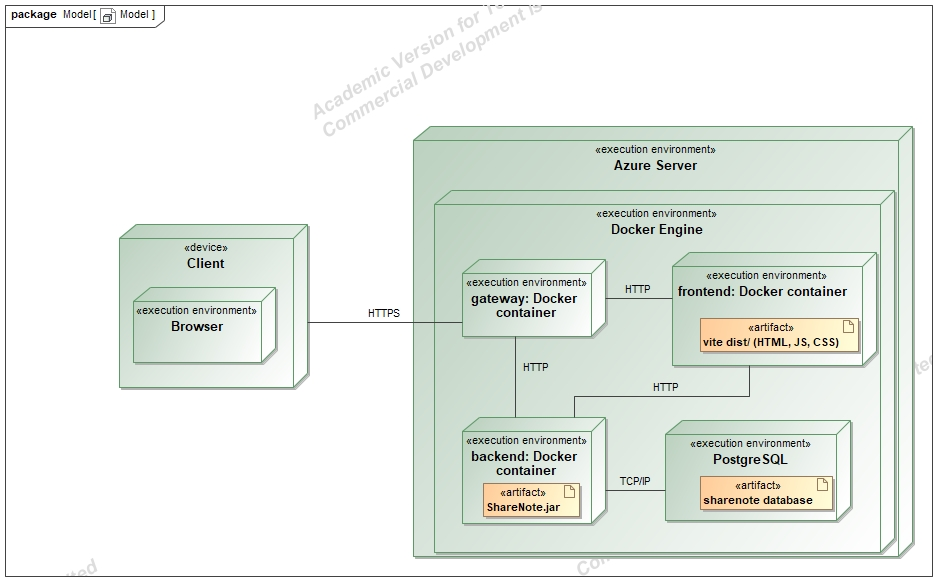

| Komponentas | Technologijos ir atsakomybė |
| --- | --- |
| Naršyklės klientas | React 19, Vite 6, JavaScript ir CSS; formos, navigacija, paieška, rezultatų pateikimas ir HTTP užklausos. |
| `frontend` | Nginx pateikia Vite sukurtus statinius failus ir perduoda `/api/` užklausas į `api:8080`. |
| `api` | Java 21, Spring Boot 3.5.5, Spring Security; autentifikavimas, vaidmenys, validacija, CRUD ir klaidų atsakymai. |
| `db` | PostgreSQL 17; organizacijų, grupių, užrašų ir paskyrų lentelės, išoriniai raktai ir nuolatinis duomenų saugojimas. |
| Migracijos | Flyway paleidimo metu sukuria / atnaujina schemą ir pradinius demonstracinius duomenis. |
| Azure tarpinis serveris | Caddy 2 priima HTTPS, nukreipia į frontend, o Swagger ir OpenAPI užklausas – tiesiai į API. |

API kontroleriai priima HTTP užklausas, `ShareNoteService` vykdo dalykinę logiką ir SQL per `JdbcClient`, o `AuthService` valdo paskyras bei žetonus. `ApiErrors` vienodina klaidas į `application/problem+json`. Ryšiai duomenų bazėje: `organizations 1 — 0..* groups`, `groups 1 — 0..* notes`; iš grupės pusės organizacija privaloma, iš užrašo pusės grupė privaloma. `sessions` saugo prisijungimo sesijas, įrenginį, paskutinio atnaujinimo JWT maišą ir atšaukimo būseną. `app_users` saugo paskyras ir vaidmenis, bet neturi narystės ryšių su grupėmis.

Vietinis [compose.yaml](compose.yaml) paleidžia tik PostgreSQL; React / Vite ir Java API veikia vietiniuose procesuose: sąsaja pasiekiama per `localhost:3000`, API – `localhost:8080`, PostgreSQL – `localhost:5433` (konteinerio prievadas 5432). Azure [konfigūracijoje](deploy/compose.azure.yaml) viešai atveriami tik Caddy 80 ir 443 prievadai; kiti servisai bendrauja vidiniame Docker tinkle. PostgreSQL duomenys laikomi `postgres-data` tome.

## 3. Naudotojo sąsajos projektas ir realizacija

Kiekvienas scheminis lango projektas (**wireframe**) susietas su jį atitinkančia realizacijos iškarpa. Schemos parengtos pagal dabartinę realizaciją ir nėra ankstesnio projektavimo proceso įrodymas. Iškarpos užfiksuotos iš veikiančios vietinės React sąsajos su demonstraciniais API atsakymais (`Universitetas`, `Saityno technologijos`, `HTTP metodai`). Jos parodo tikrą sąsajos kodą, tačiau nėra integracijos su veikiančiu serveriu patikra. Fotografavimo scenarijus: [scripts/capture-report.mjs](scripts/capture-report.mjs).

### 3.1. Prisijungimas ir registracija

```text
+------------------------------------------------------------------+
| ShareNote                                      Sistemos šūkis     |
+--------------------------------+---------------------------------+
| Sistemos paskirtis              | Prisijungimo / registracijos      |
| Antraštė ir trumpas aprašymas   | antraštė                          |
|                                | Naudotojo vardas [_____________]  |
| Užrašinės iliustracija          | Slaptažodis      [_____________]  |
|                                | [ ] Rodyti slaptažodį             |
|                                | [Klaidos pranešimas, jei yra]     |
|                                | [Prisijungti / Sukurti paskyrą]   |
|                                | [Registruotis / Prisijungti]      |
+--------------------------------+---------------------------------+
| Sistemos pavadinimas                            [Apie ir pagalba] |
+------------------------------------------------------------------+
```

Prisijungimas ir registracija naudoja tą patį maketą. Registracija suteikia skaitytojo teises. Slaptažodžio rodymą galima įjungti, o vykstant užklausai pateikimo mygtukas išjungiamas.

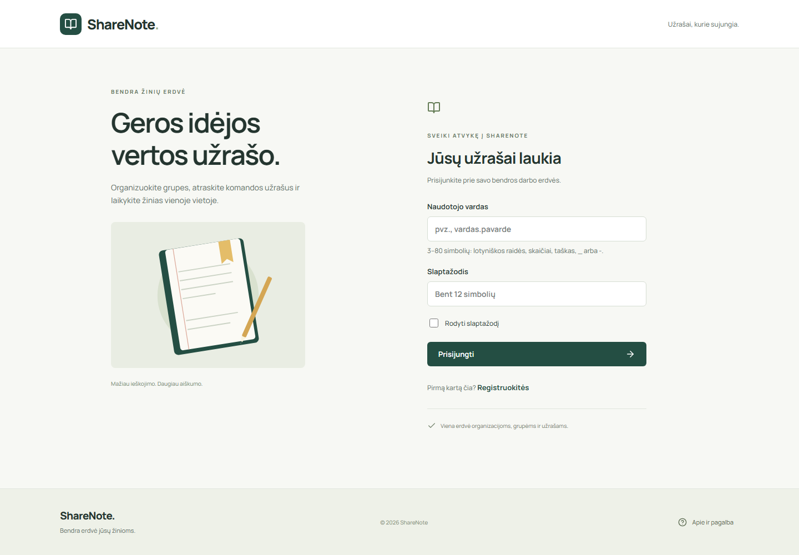


### 3.2. Užrašų, grupių ir organizacijų sąrašai

```text
+------------------------------------------------------------------+
| ShareNote       [Užrašai] [Grupės] [Organizacijos]  Vardas [Išeiti] |
+------------------------------------------------------------------+
| Darbo erdvė > Skiltis                                             |
| Skilties antraštė (kiekis)                   [+ Sukurti įrašą]*    |
+-------------------+----------------------------------------------+
| BIBLIOTEKA        | [Ieškoti........................] [Filtras] [↻] |
| Užrašai           | VISI ĮRAŠAI                           Kiekis  |
| Grupės            | Ikona | Kategorija / priklausomybė             |
| Organizacijos     |       | Pavadinimas                           |
|                   |       | Turinio / aprašymo ištrauka       [>] |
| Pagalba           |----------------------------------------------|
| Prieigos teisės   | Kiti įrašai arba tuščios būsenos paaiškinimas  |
+-------------------+----------------------------------------------+
* Administratoriui; užrašus kurti gali ir redaktorius. Organizacijų sąraše ryšio filtro nėra.
```

Visos trys skiltys naudoja vienodą navigaciją ir sąrašo struktūrą. Užrašų filtras parenka grupę, grupių filtras – organizaciją. Paieška ir sąsajos filtrai vykdomi naršyklėje jau gautiems duomenims.

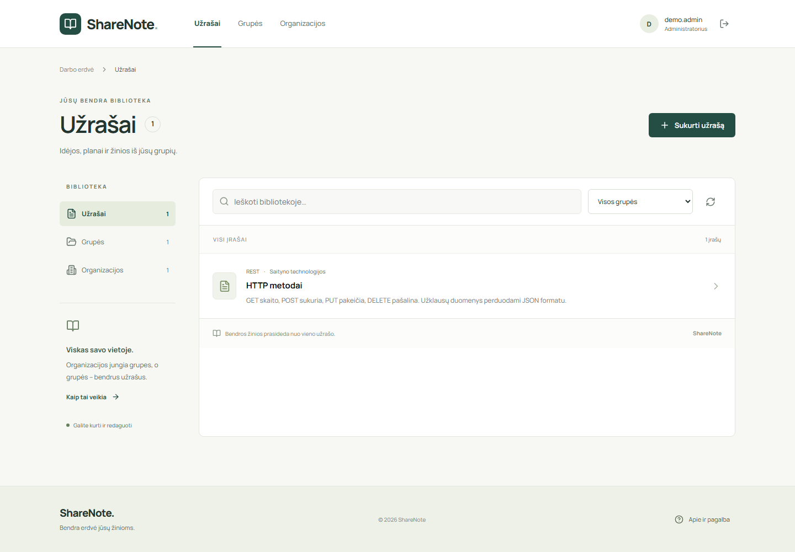

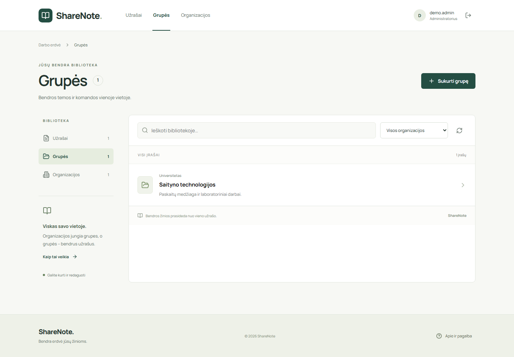

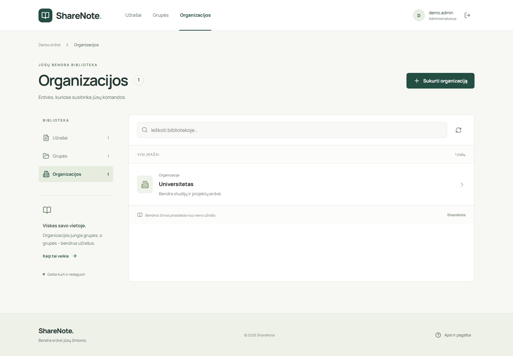

### 3.3. Sukūrimo ir redagavimo dialogai

```text
+--------------------------------------------------+
| Sukurti / Redaguoti užrašą                    [X] |
| Antraštė [_____________________________________] |
| Kategorija [____________]  Grupė [Pasirinkti    v] |
| Užrašo turinys                                    |
| [______________________________________________] |
| [______________________________________________] |
| Ilgio apribojimas / klaidos pranešimas             |
|                         [Atšaukti] [Išsaugoti]    |
+--------------------------------------------------+

+--------------------------------------------------+
| Sukurti / Redaguoti grupę                     [X] |
| Pavadinimas [__________________________________] |
| Organizacija [Pasirinkite organizaciją       v] |
| Aprašymas [____________________________________] |
|                         [Atšaukti] [Išsaugoti]    |
+--------------------------------------------------+

+--------------------------------------------------+
| Sukurti / Redaguoti organizaciją              [X] |
| Pavadinimas [__________________________________] |
| Aprašymas [____________________________________] |
|                         [Atšaukti] [Išsaugoti]    |
+--------------------------------------------------+
```

Redaguojant tas pats dialogas užpildomas esamomis reikšmėmis. Sukūrimui siunčiamas POST, pakeitimui – PUT. Užrašo negalima išsaugoti nepasirinkus grupės; jei grupių nėra, pateikiamas paaiškinimas. Organizacijos ryšys grupės formoje privalomas; jei organizacijų nėra, pirmiausia reikia sukurti organizaciją.

| Užrašo sukūrimas | Užrašo redagavimas |
| --- | --- |
| 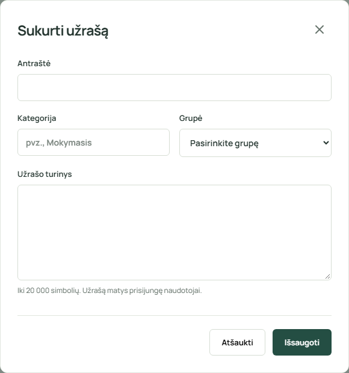 | 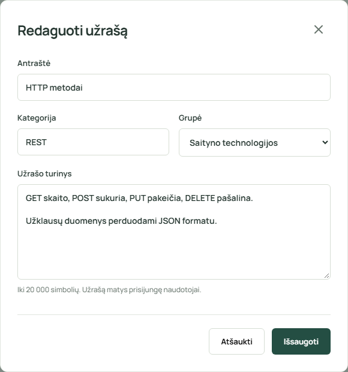 |

| Grupės forma | Organizacijos forma |
| --- | --- |
| 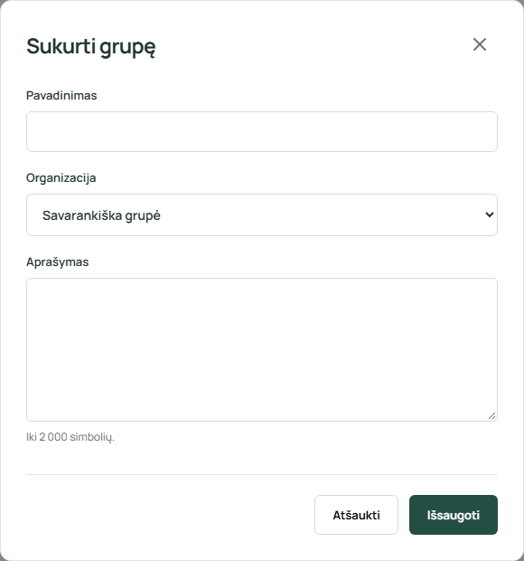 | 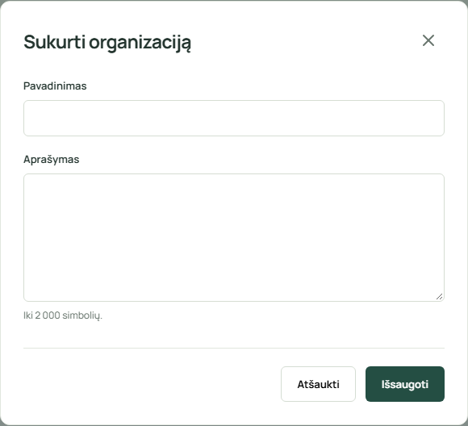 |

### 3.4. Peržiūra ir trynimo patvirtinimas

```text
+--------------------------------------------------+
| Įrašo pavadinimas                             [X] |
| Kategorija / ištekliaus tipas                     |
| Visas turinys arba aprašymas                      |
| Grupė / organizacija (kai taikoma)                |
|                         [Ištrinti]* [Redaguoti]*  |
+--------------------------------------------------+
* Administratoriui arba savo užrašą atidariusiam redaktoriui.

+--------------------------------------------------+
| Ištrinti įrašą?                               [X] |
| Įrašo pavadinimas ir negrįžtamo veiksmo aprašymas  |
| Priklausomybių paaiškinimas / klaida, jei taikoma  |
|                      [Atšaukti] [Taip, ištrinti]  |
+--------------------------------------------------+
```

Paspaudus įrašą, jo aktualūs duomenys paimami GET užklausa pagal ID. Trynimas vykdomas tik patvirtinus. Jei serveris grąžina 409, dialoge išlieka ryšių konflikto paaiškinimas.

| Peržiūros dialogas | Trynimo dialogas |
| --- | --- |
| 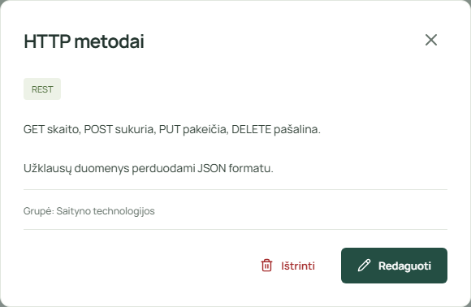 | 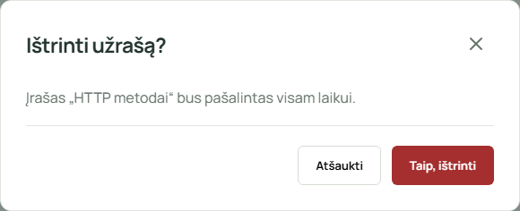 |

### 3.5. Pagalba ir mobilioji sąsaja

```text
+---------------------------------------+
| Jūsų ShareNote erdvė               [X] |
| Organizacijų, grupių ir užrašų ryšiai   |
| Kaip pradėti?                         |
| Prieigos teisės ir trynimo tvarka      |
| [Supratau]                            |
+---------------------------------------+

+-----------------------------+
| ShareNote               [☰] |
| Darbo erdvė > Užrašai        |
| Užrašai (kiekis)             |
| [+ Sukurti užrašą]*          |
| [Ieškoti..................] |
| [Grupės filtras]        [↻] |
| Įrašo pavadinimas       [>] |
| Turinio ištrauka            |
| [Apie ir pagalba]           |
+-----------------------------+
```

Mobiliajame vaizde šoninė juosta paslepiama, o navigacija atidaroma meniu mygtuku. Dialogai palaiko uždarymą Escape klavišu ir grąžina fokusą į juos atidariusį valdiklį; vykstant išsaugojimui ar trynimui uždarymas blokuojamas.

| Pagalba | Mobilusis vaizdas |
| --- | --- |
| 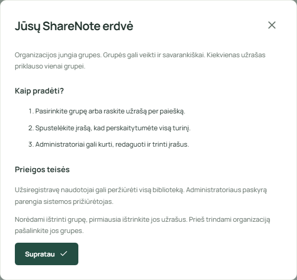 | 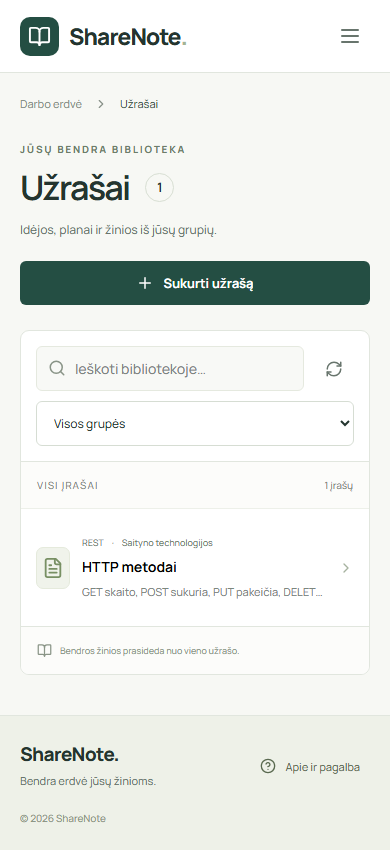 |

## 4. API specifikacija

Atskiras [api-spec.yaml](api-spec.yaml) failas aprašo **OpenAPI 3.0.1** formatu visas 19 operacijų: parametrus, įvesties ir išvesties schemas, autentifikavimą, atsakymų kodus bei JSON pavyzdžius. Jis parengtas pagal kontrolerius, servisus ir saugos konfigūraciją, patikslinus automatinį [docs/openapi.json](docs/openapi.json) eksportą.

### Hierarchical resource routes

Groups belong under organizations, and notes under groups:

| Collection | Individual resource | Methods |
| --- | --- | --- |
| `/api/organizations/{organizationId}/groups` | `/api/organizations/{organizationId}/groups/{groupId}` | GET / POST on collections; GET / PUT / DELETE on items |
| `/api/organizations/{organizationId}/groups/{groupId}/notes` | `/api/organizations/{organizationId}/groups/{groupId}/notes/{id}` | GET / POST on collections; GET / PUT / DELETE on items |

For example, `GET /api/organizations/1/groups/2` fetches group 2 in organization 1. Collection and item URLs alternate resource names and IDs; group item URLs retain `/groups` before the group ID.

The URL supplies the parent. For example, `POST /api/organizations/1/groups/1/notes` accepts `{"title":"HTTP methods","content":"GET reads.","category":"REST"}`. Omit `groupId` from this body; likewise, omit `organizationId` when writing a group under an organization. Unknown fields, including parent IDs in these nested request bodies, return 400. Created resources return their nested URL in `Location`.

A missing parent or a child belonging to a different parent returns 404. USER, EDITOR and ADMIN may read. ADMIN manages all resources; EDITOR creates notes and updates or deletes only their own notes. Validation and deletion conflicts follow the existing API rules.

The frontend uses only hierarchical paths for child lists, creation, details, edits, and deletion. Every group requires an existing organization and every note requires an existing group. The URL determines the parent, which cannot be changed on edit. Database NOT NULL and foreign-key constraints enforce membership; deleting a parent with children returns 409. The forms require parent selection and disable saving when no parents exist.

Migration V5 preserves any previously standalone groups and their notes by assigning those groups to a newly created **Imported groups** organization, then makes `groups.organization_id` NOT NULL. The migration creates that organization only if unassigned groups exist.

The API has 19 operations: 15 hierarchical resource operations and four authentication operations. No flat group or note endpoints are registered.

### 4.1. Bendros taisyklės

- Bazinis vietinis URL: `http://localhost:8080`.
- Išteklių metodams siunčiama `Authorization: Bearer <JWT>`. Vietoje `<JWT>` naudojamas prisijungimo atsakymo `accessToken`. Organizacijas ir grupes valdo ADMIN. Užrašus kuria EDITOR arba ADMIN; EDITOR keičia ir trina tik savo užrašus.
- Registracija, prisijungimas, žetonų atnaujinimas ir atsijungimas vieši; pastariesiems dviem reikia refreshToken užklausos kūne. Registruojantis negalima pasirinkti EDITOR ar ADMIN vaidmens. Net viešam metodui pateikus netinkamą Bearer žetoną, saugos filtras gali grąžinti 401.
- Užklausos kūnas ir sėkmingi atsakymai naudoja `application/json`, klaidos – `application/problem+json`. DELETE sėkmės atsakymas 204 neturi kūno.
- Sąrašai surikiuoti pagal ID didėjimo tvarka ir gali būti tušti. Neprivalomi `page` (nuo 0) ir `size` (1–100) įjungia puslapiavimą; numatyta 0 ir 10. Praleidus abu parametrus grąžinamas visas sąrašas.
- Group and note lists are scoped to the parent IDs in the URL. A missing parent returns 404.
- PUT pakeičia visus redaguojamus laukus ir nesukuria naujo ištekliaus. Grupės organizaciją ir užrašo grupę nurodo URL; tėvinio ištekliaus ID į JSON kūną nededamas.
- Nežinomi JSON laukai ir netinkami tipai atmetami. PATCH nerealizuotas.
- Pavyzdžių ID ir duomenys iliustraciniai. Skaitymo, keitimo ir trynimo pavyzdžiuose laikoma, kad įrašai jau egzistuoja. Kuriant naudojamas serverio grąžintas ID. `<gautas-JWT>` žymi vietą tikram žetonui ir nėra galiojantis žetonas.

### 4.2. Atsakymų kodai

| Kodas | Reikšmė |
| --- | --- |
| 200 | Sėkmingas skaitymas, pakeitimas arba prisijungimas. |
| 201 | Sukurta paskyra arba išteklius. Išteklių CRUD atveju pateikiama `Location` antraštė. |
| 204 | Išteklius ištrintas arba atnaujinimo žetonas atšauktas; kūnas tuščias. |
| 400 | Netaisyklingas JSON, nežinomas laukas, netinkamas tipas arba puslapiavimo parametrai. |
| 401 | Trūksta galiojančio JWT arba neteisingi prisijungimo duomenys. |
| 403 | Vaidmuo neleidžia operacijos. |
| 404 | Išteklius arba susijęs išteklius nerastas. |
| 406 | Accept prašo nepalaikomo formato. |
| 409 | Užimtas naudotojo vardas arba DB ryšių konfliktas. |
| 415 | Content-Type turi būti application/json. |
| 422 | Laukai neatitinka validacijos reikalavimų. |

Toliau nurodyti kiekvieno metodo sėkmės ir numatomi kliento klaidų kodai. Netikėti serverio ar infrastruktūros sutrikimai gali papildomai sukelti 5xx. Jei užklausa pažeidžia kelias taisykles, pirmiausia ją gali atmesti saugos filtras. 406 klaidos kūnas priklauso ir nuo to, ar `Accept` leidžia klaidos formatą.

### 4.3. Metodų suvestinė

| Metodas | Kelias | Prieiga | Atsakymų kodai |
| --- | --- | --- | --- |
| GET | `/api/organizations/{id}` | USER, EDITOR, ADMIN | 200, 400, 401, 403, 404, 406 |
| PUT | `/api/organizations/{id}` | ADMIN | 200, 400, 401, 403, 404, 406, 409, 415, 422 |
| DELETE | `/api/organizations/{id}` | ADMIN | 204, 400, 401, 403, 404, 409 |
| GET | `/api/organizations` | USER, EDITOR, ADMIN | 200, 400, 401, 403, 406 |
| POST | `/api/organizations` | ADMIN | 201, 400, 401, 403, 406, 409, 415, 422 |
| POST | `/api/auth/register` | Vieša | 201, 400, 401, 406, 409, 415, 422 |
| POST | `/api/auth/refresh` | Vieša | 200, 400, 401, 406, 415, 422 |
| POST | `/api/auth/logout` | Vieša | 204, 400, 401, 415, 422 |
| POST | `/api/auth/login` | Vieša | 200, 400, 401, 406, 415, 422 |
| GET | `/api/organizations/{organizationId}/groups` | USER, EDITOR, ADMIN | 200, 400, 401, 403, 404, 406 |
| POST | `/api/organizations/{organizationId}/groups` | ADMIN | 201, 400, 401, 403, 404, 406, 409, 415, 422 |
| GET | `/api/organizations/{organizationId}/groups/{groupId}` | USER, EDITOR, ADMIN | 200, 400, 401, 403, 404, 406 |
| PUT | `/api/organizations/{organizationId}/groups/{groupId}` | ADMIN | 200, 400, 401, 403, 404, 406, 409, 415, 422 |
| DELETE | `/api/organizations/{organizationId}/groups/{groupId}` | ADMIN | 204, 400, 401, 403, 404, 409 |
| GET | `/api/organizations/{organizationId}/groups/{groupId}/notes` | USER, EDITOR, ADMIN | 200, 400, 401, 403, 404, 406 |
| POST | `/api/organizations/{organizationId}/groups/{groupId}/notes` | EDITOR, ADMIN | 201, 400, 401, 403, 404, 406, 409, 415, 422 |
| GET | `/api/organizations/{organizationId}/groups/{groupId}/notes/{id}` | USER, EDITOR, ADMIN | 200, 400, 401, 403, 404, 406 |
| PUT | `/api/organizations/{organizationId}/groups/{groupId}/notes/{id}` | ADMIN arba savininkas EDITOR | 200, 400, 401, 403, 404, 406, 409, 415, 422 |
| DELETE | `/api/organizations/{organizationId}/groups/{groupId}/notes/{id}` | ADMIN arba savininkas EDITOR | 204, 400, 401, 403, 404 |

### 4.4. Kiekvieno metodo panaudojimo pavyzdžiai

Žetonai ir ID iliustraciniai. Pavyzdžiai nepriklausomi; tėviniai ištekliai turi egzistuoti. Po sukūrimo naudokite tikrą atsakymo ID ir `Location`. Registracija suteikia USER vaidmenį; rašymo pavyzdžiams reikia atitinkamas teises turinčios paskyros JWT. `refreshExpiresAt` yra absoliutus laikas Unix milisekundėmis.

#### 1. `GET /api/organizations/{id}`

Prieiga: **USER, EDITOR, ADMIN**. Atsakymų kodai: **200, 400, 401, 403, 404, 406**.

Užklausa:

```http
GET /api/organizations/1 HTTP/1.1
Host: localhost:8080
Accept: application/json, application/problem+json
Authorization: Bearer <JWT>
```

Atsakymas:

```http
HTTP/1.1 200 OK
Content-Type: application/json

{
  "id": 1,
  "name": "Universitetas",
  "description": "Bendra studijų erdvė.",
  "_links": {
    "self": {
      "href": "/api/organizations/1"
    },
    "collection": {
      "href": "/api/organizations"
    },
    "groups": {
      "href": "/api/organizations/1/groups"
    }
  }
}
```

#### 2. `PUT /api/organizations/{id}`

Prieiga: **ADMIN**. Atsakymų kodai: **200, 400, 401, 403, 404, 406, 409, 415, 422**.

Užklausa:

```http
PUT /api/organizations/1 HTTP/1.1
Host: localhost:8080
Accept: application/json, application/problem+json
Authorization: Bearer <JWT>
Content-Type: application/json

{
  "name": "Universitetas (atnaujinta)",
  "description": "Bendra studijų erdvė."
}
```

Atsakymas:

```http
HTTP/1.1 200 OK
Content-Type: application/json

{
  "id": 1,
  "name": "Universitetas (atnaujinta)",
  "description": "Bendra studijų erdvė.",
  "_links": {
    "self": {
      "href": "/api/organizations/1"
    },
    "collection": {
      "href": "/api/organizations"
    },
    "groups": {
      "href": "/api/organizations/1/groups"
    }
  }
}
```

#### 3. `DELETE /api/organizations/{id}`

Prieiga: **ADMIN**. Atsakymų kodai: **204, 400, 401, 403, 404, 409**.

Užklausa:

```http
DELETE /api/organizations/1 HTTP/1.1
Host: localhost:8080
Accept: application/json, application/problem+json
Authorization: Bearer <JWT>
```

Atsakymas:

```http
HTTP/1.1 204 No Content
```

Atsakymo kūnas tuščias.

#### 4. `GET /api/organizations`

Prieiga: **USER, EDITOR, ADMIN**. Atsakymų kodai: **200, 400, 401, 403, 406**.

Užklausa:

```http
GET /api/organizations?page=0&size=10 HTTP/1.1
Host: localhost:8080
Accept: application/json, application/problem+json
Authorization: Bearer <JWT>
```

Atsakymas:

```http
HTTP/1.1 200 OK
Content-Type: application/json

[
  {
    "id": 1,
    "name": "Universitetas",
    "description": "Bendra studijų erdvė.",
    "_links": {
      "self": {
        "href": "/api/organizations/1"
      },
      "collection": {
        "href": "/api/organizations"
      },
      "groups": {
        "href": "/api/organizations/1/groups"
      }
    }
  }
]
```

#### 5. `POST /api/organizations`

Prieiga: **ADMIN**. Atsakymų kodai: **201, 400, 401, 403, 406, 409, 415, 422**.

Užklausa:

```http
POST /api/organizations HTTP/1.1
Host: localhost:8080
Accept: application/json, application/problem+json
Authorization: Bearer <JWT>
Content-Type: application/json

{
  "name": "Universitetas",
  "description": "Bendra studijų erdvė."
}
```

Atsakymas:

```http
HTTP/1.1 201 Created
Location: /api/organizations/1
Content-Type: application/json

{
  "id": 1,
  "name": "Universitetas",
  "description": "Bendra studijų erdvė.",
  "_links": {
    "self": {
      "href": "/api/organizations/1"
    },
    "collection": {
      "href": "/api/organizations"
    },
    "groups": {
      "href": "/api/organizations/1/groups"
    }
  }
}
```

#### 6. `POST /api/auth/register`

Prieiga: **Vieša**. Atsakymų kodai: **201, 400, 401, 406, 409, 415, 422**.

Užklausa:

```http
POST /api/auth/register HTTP/1.1
Host: localhost:8080
Accept: application/json, application/problem+json
Content-Type: application/json

{
  "username": "studentas",
  "password": "Pavyzdinis-123!"
}
```

Atsakymas:

```http
HTTP/1.1 201 Created
Cache-Control: no-store
Content-Type: application/json

{
  "accessToken": "<gautas-JWT>",
  "tokenType": "Bearer",
  "expiresIn": 180,
  "refreshToken": "<gautas-refresh-JWT>",
  "refreshExpiresAt": 1793275200000
}
```

#### 7. `POST /api/auth/refresh`

Prieiga: **Vieša**. Atsakymų kodai: **200, 400, 401, 406, 415, 422**.

Užklausa:

```http
POST /api/auth/refresh HTTP/1.1
Host: localhost:8080
Accept: application/json, application/problem+json
Content-Type: application/json

{
  "refreshToken": "<gautas-refresh-JWT>"
}
```

Atsakymas:

```http
HTTP/1.1 200 OK
Cache-Control: no-store
Content-Type: application/json

{
  "accessToken": "<gautas-JWT>",
  "tokenType": "Bearer",
  "expiresIn": 180,
  "refreshToken": "<gautas-refresh-JWT>",
  "refreshExpiresAt": 1793275200000
}
```

#### 8. `POST /api/auth/logout`

Prieiga: **Vieša**. Atsakymų kodai: **204, 400, 401, 415, 422**.

Užklausa:

```http
POST /api/auth/logout HTTP/1.1
Host: localhost:8080
Accept: application/json, application/problem+json
Content-Type: application/json

{
  "refreshToken": "<gautas-refresh-JWT>"
}
```

Atsakymas:

```http
HTTP/1.1 204 No Content
Cache-Control: no-store
```

Atsakymo kūnas tuščias.

#### 9. `POST /api/auth/login`

Prieiga: **Vieša**. Atsakymų kodai: **200, 400, 401, 406, 415, 422**.

Užklausa:

```http
POST /api/auth/login HTTP/1.1
Host: localhost:8080
Accept: application/json, application/problem+json
Content-Type: application/json

{
  "username": "studentas",
  "password": "Pavyzdinis-123!"
}
```

Atsakymas:

```http
HTTP/1.1 200 OK
Cache-Control: no-store
Content-Type: application/json

{
  "accessToken": "<gautas-JWT>",
  "tokenType": "Bearer",
  "expiresIn": 180,
  "refreshToken": "<gautas-refresh-JWT>",
  "refreshExpiresAt": 1793275200000
}
```

#### 10. `GET /api/organizations/{organizationId}/groups`

Prieiga: **USER, EDITOR, ADMIN**. Atsakymų kodai: **200, 400, 401, 403, 404, 406**.

Užklausa:

```http
GET /api/organizations/1/groups?page=0&size=10 HTTP/1.1
Host: localhost:8080
Accept: application/json, application/problem+json
Authorization: Bearer <JWT>
```

Atsakymas:

```http
HTTP/1.1 200 OK
Content-Type: application/json

[
  {
    "id": 1,
    "name": "Saityno technologijos",
    "description": "Kurso užrašai.",
    "organizationId": 1,
    "_links": {
      "self": {
        "href": "/api/organizations/1/groups/1"
      },
      "collection": {
        "href": "/api/organizations/1/groups"
      },
      "organization": {
        "href": "/api/organizations/1"
      },
      "notes": {
        "href": "/api/organizations/1/groups/1/notes"
      }
    }
  }
]
```

#### 11. `POST /api/organizations/{organizationId}/groups`

Prieiga: **ADMIN**. Atsakymų kodai: **201, 400, 401, 403, 404, 406, 409, 415, 422**.

Užklausa:

```http
POST /api/organizations/1/groups HTTP/1.1
Host: localhost:8080
Accept: application/json, application/problem+json
Authorization: Bearer <JWT>
Content-Type: application/json

{
  "name": "Saityno technologijos",
  "description": "Paskaitų medžiaga."
}
```

Atsakymas:

```http
HTTP/1.1 201 Created
Location: /api/organizations/1/groups/1
Content-Type: application/json

{
  "id": 1,
  "name": "Saityno technologijos",
  "description": "Paskaitų medžiaga.",
  "organizationId": 1,
  "_links": {
    "self": {
      "href": "/api/organizations/1/groups/1"
    },
    "collection": {
      "href": "/api/organizations/1/groups"
    },
    "organization": {
      "href": "/api/organizations/1"
    },
    "notes": {
      "href": "/api/organizations/1/groups/1/notes"
    }
  }
}
```

#### 12. `GET /api/organizations/{organizationId}/groups/{groupId}`

Prieiga: **USER, EDITOR, ADMIN**. Atsakymų kodai: **200, 400, 401, 403, 404, 406**.

Užklausa:

```http
GET /api/organizations/1/groups/1 HTTP/1.1
Host: localhost:8080
Accept: application/json, application/problem+json
Authorization: Bearer <JWT>
```

Atsakymas:

```http
HTTP/1.1 200 OK
Content-Type: application/json

{
  "id": 1,
  "name": "Saityno technologijos",
  "description": "Kurso užrašai.",
  "organizationId": 1,
  "_links": {
    "self": {
      "href": "/api/organizations/1/groups/1"
    },
    "collection": {
      "href": "/api/organizations/1/groups"
    },
    "organization": {
      "href": "/api/organizations/1"
    },
    "notes": {
      "href": "/api/organizations/1/groups/1/notes"
    }
  }
}
```

#### 13. `PUT /api/organizations/{organizationId}/groups/{groupId}`

Prieiga: **ADMIN**. Atsakymų kodai: **200, 400, 401, 403, 404, 406, 409, 415, 422**.

Užklausa:

```http
PUT /api/organizations/1/groups/1 HTTP/1.1
Host: localhost:8080
Accept: application/json, application/problem+json
Authorization: Bearer <JWT>
Content-Type: application/json

{
  "name": "Saityno technologijos (atnaujinta)",
  "description": "Paskaitų medžiaga."
}
```

Atsakymas:

```http
HTTP/1.1 200 OK
Content-Type: application/json

{
  "id": 1,
  "name": "Saityno technologijos (atnaujinta)",
  "description": "Paskaitų medžiaga.",
  "organizationId": 1,
  "_links": {
    "self": {
      "href": "/api/organizations/1/groups/1"
    },
    "collection": {
      "href": "/api/organizations/1/groups"
    },
    "organization": {
      "href": "/api/organizations/1"
    },
    "notes": {
      "href": "/api/organizations/1/groups/1/notes"
    }
  }
}
```

#### 14. `DELETE /api/organizations/{organizationId}/groups/{groupId}`

Prieiga: **ADMIN**. Atsakymų kodai: **204, 400, 401, 403, 404, 409**.

Užklausa:

```http
DELETE /api/organizations/1/groups/1 HTTP/1.1
Host: localhost:8080
Accept: application/json, application/problem+json
Authorization: Bearer <JWT>
```

Atsakymas:

```http
HTTP/1.1 204 No Content
```

Atsakymo kūnas tuščias.

#### 15. `GET /api/organizations/{organizationId}/groups/{groupId}/notes`

Prieiga: **USER, EDITOR, ADMIN**. Atsakymų kodai: **200, 400, 401, 403, 404, 406**.

Užklausa:

```http
GET /api/organizations/1/groups/1/notes?page=0&size=10 HTTP/1.1
Host: localhost:8080
Accept: application/json, application/problem+json
Authorization: Bearer <JWT>
```

Atsakymas:

```http
HTTP/1.1 200 OK
Content-Type: application/json

[
  {
    "id": 1,
    "title": "HTTP metodai",
    "content": "GET skaito, POST kuria, PUT pakeičia, DELETE šalina.",
    "category": "REST",
    "groupId": 1,
    "ownerId": 2,
    "priority": "MEDIUM",
    "group": {
      "id": 1,
      "name": "Saityno technologijos",
      "description": "Kurso užrašai.",
      "organizationId": 1,
      "_links": {
        "self": {
          "href": "/api/organizations/1/groups/1"
        },
        "collection": {
          "href": "/api/organizations/1/groups"
        },
        "organization": {
          "href": "/api/organizations/1"
        },
        "notes": {
          "href": "/api/organizations/1/groups/1/notes"
        }
      }
    },
    "_links": {
      "self": {
        "href": "/api/organizations/1/groups/1/notes/1"
      },
      "collection": {
        "href": "/api/organizations/1/groups/1/notes"
      },
      "group": {
        "href": "/api/organizations/1/groups/1"
      },
      "organization": {
        "href": "/api/organizations/1"
      }
    }
  }
]
```

#### 16. `POST /api/organizations/{organizationId}/groups/{groupId}/notes`

Prieiga: **EDITOR, ADMIN**. Atsakymų kodai: **201, 400, 401, 403, 404, 406, 409, 415, 422**.

Užklausa:

```http
POST /api/organizations/1/groups/1/notes HTTP/1.1
Host: localhost:8080
Accept: application/json, application/problem+json
Authorization: Bearer <JWT>
Content-Type: application/json

{
  "title": "HTTP metodai",
  "content": "GET skaito, POST sukuria.",
  "category": "REST",
  "priority": "MEDIUM"
}
```

Atsakymas:

```http
HTTP/1.1 201 Created
Location: /api/organizations/1/groups/1/notes/1
Content-Type: application/json

{
  "id": 1,
  "title": "HTTP metodai",
  "content": "GET skaito, POST sukuria.",
  "category": "REST",
  "groupId": 1,
  "ownerId": 2,
  "priority": "MEDIUM",
  "group": {
    "id": 1,
    "name": "Saityno technologijos",
    "description": "Kurso užrašai.",
    "organizationId": 1,
    "_links": {
      "self": {
        "href": "/api/organizations/1/groups/1"
      },
      "collection": {
        "href": "/api/organizations/1/groups"
      },
      "organization": {
        "href": "/api/organizations/1"
      },
      "notes": {
        "href": "/api/organizations/1/groups/1/notes"
      }
    }
  },
  "_links": {
    "self": {
      "href": "/api/organizations/1/groups/1/notes/1"
    },
    "collection": {
      "href": "/api/organizations/1/groups/1/notes"
    },
    "group": {
      "href": "/api/organizations/1/groups/1"
    },
    "organization": {
      "href": "/api/organizations/1"
    }
  }
}
```

#### 17. `GET /api/organizations/{organizationId}/groups/{groupId}/notes/{id}`

Prieiga: **USER, EDITOR, ADMIN**. Atsakymų kodai: **200, 400, 401, 403, 404, 406**.

Užklausa:

```http
GET /api/organizations/1/groups/1/notes/1 HTTP/1.1
Host: localhost:8080
Accept: application/json, application/problem+json
Authorization: Bearer <JWT>
```

Atsakymas:

```http
HTTP/1.1 200 OK
Content-Type: application/json

{
  "id": 1,
  "title": "HTTP metodai",
  "content": "GET skaito, POST kuria, PUT pakeičia, DELETE šalina.",
  "category": "REST",
  "groupId": 1,
  "ownerId": 2,
  "priority": "MEDIUM",
  "group": {
    "id": 1,
    "name": "Saityno technologijos",
    "description": "Kurso užrašai.",
    "organizationId": 1,
    "_links": {
      "self": {
        "href": "/api/organizations/1/groups/1"
      },
      "collection": {
        "href": "/api/organizations/1/groups"
      },
      "organization": {
        "href": "/api/organizations/1"
      },
      "notes": {
        "href": "/api/organizations/1/groups/1/notes"
      }
    }
  },
  "_links": {
    "self": {
      "href": "/api/organizations/1/groups/1/notes/1"
    },
    "collection": {
      "href": "/api/organizations/1/groups/1/notes"
    },
    "group": {
      "href": "/api/organizations/1/groups/1"
    },
    "organization": {
      "href": "/api/organizations/1"
    }
  }
}
```

#### 18. `PUT /api/organizations/{organizationId}/groups/{groupId}/notes/{id}`

Prieiga: **ADMIN arba savininkas EDITOR**. Atsakymų kodai: **200, 400, 401, 403, 404, 406, 409, 415, 422**.

Užklausa:

```http
PUT /api/organizations/1/groups/1/notes/1 HTTP/1.1
Host: localhost:8080
Accept: application/json, application/problem+json
Authorization: Bearer <JWT>
Content-Type: application/json

{
  "title": "HTTP metodai (atnaujinta)",
  "content": "GET skaito, POST sukuria.",
  "category": "REST",
  "priority": "MEDIUM"
}
```

Atsakymas:

```http
HTTP/1.1 200 OK
Content-Type: application/json

{
  "id": 1,
  "title": "HTTP metodai (atnaujinta)",
  "content": "GET skaito, POST sukuria.",
  "category": "REST",
  "groupId": 1,
  "ownerId": 2,
  "priority": "MEDIUM",
  "group": {
    "id": 1,
    "name": "Saityno technologijos",
    "description": "Kurso užrašai.",
    "organizationId": 1,
    "_links": {
      "self": {
        "href": "/api/organizations/1/groups/1"
      },
      "collection": {
        "href": "/api/organizations/1/groups"
      },
      "organization": {
        "href": "/api/organizations/1"
      },
      "notes": {
        "href": "/api/organizations/1/groups/1/notes"
      }
    }
  },
  "_links": {
    "self": {
      "href": "/api/organizations/1/groups/1/notes/1"
    },
    "collection": {
      "href": "/api/organizations/1/groups/1/notes"
    },
    "group": {
      "href": "/api/organizations/1/groups/1"
    },
    "organization": {
      "href": "/api/organizations/1"
    }
  }
}
```

#### 19. `DELETE /api/organizations/{organizationId}/groups/{groupId}/notes/{id}`

Prieiga: **ADMIN arba savininkas EDITOR**. Atsakymų kodai: **204, 400, 401, 403, 404**.

Užklausa:

```http
DELETE /api/organizations/1/groups/1/notes/1 HTTP/1.1
Host: localhost:8080
Accept: application/json, application/problem+json
Authorization: Bearer <JWT>
```

Atsakymas:

```http
HTTP/1.1 204 No Content
```

Atsakymo kūnas tuščias.

### 4.5. Klaidos pavyzdys

Administratorius bando sukurti užrašą be privalomos kategorijos:

```http
POST /api/organizations/1/groups/1/notes HTTP/1.1
Host: localhost:8080
Authorization: Bearer <JWT>
Content-Type: application/json
Accept: application/json, application/problem+json

{"title":"HTTP metodai","content":"GET skaito."}
```

```http
HTTP/1.1 422 Unprocessable Entity
Content-Type: application/problem+json

{
  "type": "about:blank",
  "title": "Unprocessable Entity",
  "status": 422,
  "detail": "Payload field values do not meet the validation requirements.",
  "instance": "/api/organizations/1/groups/1/notes",
  "errors": [{"field": "category", "message": "must not be blank"}]
}
```

Visų metodų klaidų atsakymų struktūros ir iliustraciniai kūnai taip pat pateikti [api-spec.yaml](api-spec.yaml). Validacijos pranešimo tekstas gali priklausyti nuo validatoriaus lokalės.


## 5. Paleidimas ir patikra

### 5.1. Vietinis paleidimas

Reikalingi Docker su Linux konteineriais, Java JDK 21 ar naujesnė versija ir Node.js su npm. Prieš pirmą paleidimą projekto šaknyje sukuriamas vietinis `.env` failas su `ADMIN_USERNAME`, `ADMIN_PASSWORD` ir, pasirinktinai, `DB_PASSWORD`. Slaptažodžiai neturi būti įtraukiami į Git; administratoriaus slaptažodis turi atitikti 1.3 skyriaus taisykles. Numatytasis administratoriaus vardas – `admin`, numatytojo administratoriaus slaptažodžio nėra. Administratoriaus sukūrimas nekeičia jau egzistuojančios paskyros slaptažodžio ir nepakelia USER teisių; jei vardas jau priklauso USER, reikia kito `ADMIN_USERNAME`.

```sh
powershell -ExecutionPolicy Bypass -File scripts/start.ps1
```

- Naudotojo sąsaja: [http://localhost:3000](http://localhost:3000).
- API dokumentacija: [Swagger UI](http://localhost:8080/swagger-ui.html).
- Dinaminė specifikacija: [OpenAPI JSON](http://localhost:8080/v3/api-docs).
- Terminalą laikykite atidarytą; `Ctrl+C` sustabdo vietinę programą. Duomenų bazės stabdymas: `docker compose down`; duomenų tomas paliekamas.
- Tik duomenų bazė: `./scripts/start.ps1 -DatabaseOnly`. Skriptas pašalina ankstesnius vietinius API ir frontend konteinerius, išsaugodamas duomenų tomą. Vietinis API naudoja šakninio `.env` nustatymus. Sąsajos žurnalai: `frontend-dev.log` ir `frontend-dev-error.log`.

### 5.2. Patikros ir jų ribos

2026-09-27 patikra sėkminga: `api-spec.yaml` validuotas su `openapi-spec-validator`, visų JSON pavyzdžių atitiktis schemoms patikrinta su `openapi-schema-validator`, patvirtintas 17 operacijų atitikimas kontroleriams, README vietinės nuorodos ir 13 sąsajos iškarpų buvimas. API integraciniai testai rengiant šią ataskaitą iš naujo neleisti. Sąsajos iškarpos sukuriamos automatizuotai su demonstraciniais API atsakymais, realiai vykdant React kodą. Tai nepakeičia API integracinių bandymų su PostgreSQL.

Saugykloje yra šios pakartojamos patikros:

| Patikra | Paleidimas | Kas tikrinama |
| --- | --- | --- |
| API integraciniai testai | `cd backend`, tada `./mvnw.cmd test` (Windows) arba `sh ./mvnw test` | CRUD, validacija, ryšiai, autentifikavimas ir autorizacija su Testcontainers PostgreSQL; reikia Java 21 ir Docker. |
| Sąsajos testai | `cd frontend`, `npm ci`, `npx playwright install chromium`, `npm test` | Administratoriaus CRUD, skaitytojo teisės, paieška, dialogai, sesijos klaidos ir prisitaikantis išdėstymas su imituojamu API. |
| Sąsajos surinkimas | `cd frontend`, `npm run build` | Vite produkcinio paketo sukūrimas. |
| Veikiančio API demonstracija | Iš šaknies `node scripts/demo.mjs` | 15 CRUD operacijų; reikia veikiančio API ir aplinkoje nustatytų administratoriaus duomenų. |
| Ataskaitos iškarpų atkūrimas | Paleisti `npm run dev -- --port 5173` iš `frontend/`, tada iš šaknies `node scripts/capture-report.mjs` | 13 React sąsajos iškarpų su nekintamais demonstraciniais duomenimis. |

Postman naudojimui pateikti [kolekcija](docs/postman/ShareNote.postman_collection.json) ir [instrukcija](docs/postman/README.md). Ankstesnių patikrų rezultatai išsaugoti [docs/verification.md](docs/verification.md); jų datos ir aprėptis netapatinamos su šios ataskaitos rengimu. Azure diegimo failai laikomi [deploy/](deploy/), papildomas aprašymas – [docs/azure.md](docs/azure.md).

## 6. Projekto išvados

1. Sukurta trijų lygių bendrų užrašų biblioteka: organizacijos, joms priskirtos grupės ir grupių užrašai. Tokia struktūra leidžia sisteminti komandos arba studijų medžiagą.
2. Realizuota 19 REST operacijų: 15 hierarchinių išteklių CRUD metodų ir keturi autentifikavimo metodai. OpenAPI specifikacija, kiekvieno metodo atsakymų kodai bei užklausų ir atsakymų pavyzdžiai sudaro aiškų kliento ir serverio sąveikos aprašą.
3. React sąsajoje įgyvendintos peržiūros, paieškos, filtravimo ir administravimo funkcijos. Vienodas sąrašų bei dialogų išdėstymas pritaikytas tiek kompiuterio, tiek telefono ekranui.
4. JWT ir serverio pusėje tikrinami vaidmenys atskiria skaitymo bei keitimo teises. Įvesties validacija ir PostgreSQL išoriniai raktai apsaugo duomenų struktūrą nuo neteisingų ryšių ir neleidžiamo trynimo.
5. Vietoje Docker Compose paleidžia tik duomenų bazę, sąsaja ir API vykdomi vietiniuose procesuose; Azure aplinkoje visi servisai konteinerizuoti. Flyway automatizuoja schemos parengimą. Saugykloje pateikta vietinio ir Azure diegimo konfigūracija.
6. Dabartinė versija skirta bendrai bibliotekai ir vienam API egzemplioriui. Tolesnės plėtros kryptys: individuali grupių narystė ir privatumas, užrašų pakeitimų istorija, serverinė paieška bei puslapiavimas, ilgalaikis JWT raktų saugojimas ir prieigos JWT atšaukimas iki galiojimo pabaigos. Šios galimybės dabartinėje realizacijoje neįgyvendintos; atnaujinimo žetonai jau atšaukiami atsijungiant.

